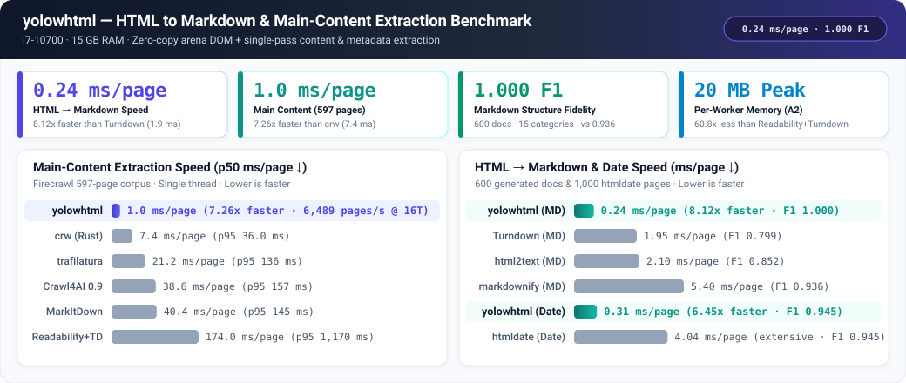
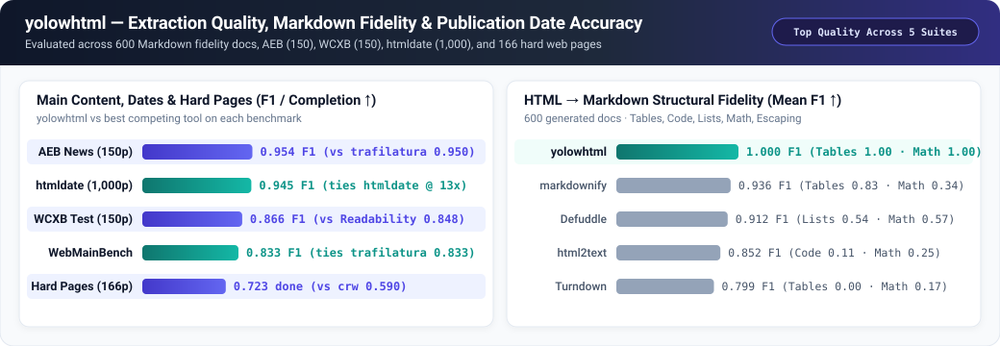
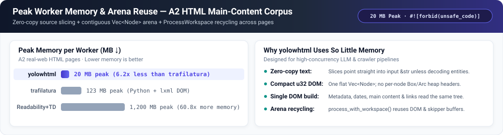
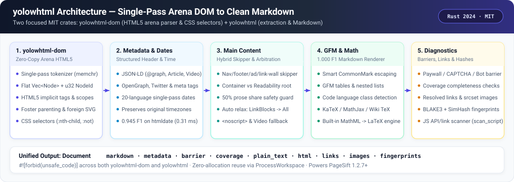

<div align="center">

# yolowhtml

**Zero-Copy Arena HTML5 Parser, Main-Content Extractor & 1.000-F1 Markdown Engine**

[**English**](README.md) · [**简体中文**](docs/README.zh-CN.md) · [**Changelog**](CHANGELOG.md)

[](https://crates.io/crates/yolowhtml)
[](https://docs.rs/yolowhtml)
[](LICENSE)
[](Cargo.toml)

</div>

A pure-Rust HTML5 parser (`yolowhtml-dom`) and main-content / Markdown / metadata / publication-date engine (`yolowhtml`), extracted from [PageSift](https://github.com/YOLOW92/pagesift) and released under the **MIT License**. Both crates enforce `#![forbid(unsafe_code)]`, parse each HTML page **exactly once** into a contiguous `Vec<Node>` arena, and convert noisy real-world web pages into clean, structure-preserving Markdown for LLM and RAG pipelines.

<p align="center">
  
</p>

---

## At a Glance

- **`yolowhtml`** (`crates/yolowhtml`): Main-content extraction, GFM Markdown generation (`1.000` mean F1 across 15 structural categories), KaTeX / MathJax / MathML → LaTeX formula recovery, 20-language publication-date extraction (`0.945` F1 at `0.31 ms/page`), JSON-LD / OpenGraph metadata, paywall & anti-bot barrier detection, completeness warnings (`Coverage`), and reusable worker arenas (`ProcessWorkspace`).
- **`yolowhtml-dom`** (`crates/yolowhtml-dom`): Zero-copy arena HTML5 parser (`Vec<Node>` + `u32` `NodeId`), HTML5 tree-building rules (implicit tags, auto-closing, foster parenting, foreign SVG/MathML, fragment & `scripting=false` modes), full HTML5 named entity decoding, and CSS selector matching (`Selector::parse`, `:nth-child`, `:not`).
- **100% Safe Rust**: `#![forbid(unsafe_code)]` in both `yolowhtml` and `yolowhtml-dom`.
- **Part of the `yolow*` Ecosystem**: Powers [PageSift](https://github.com/YOLOW92/pagesift) `1.2.7+` alongside [`yolow64`](https://github.com/YOLOW92/yolow64) and [`yolowpdf`](https://github.com/YOLOW92/yolowpdf).

## Story

When [PageSift](https://github.com/YOLOW92/pagesift) started crawling the open web for AI agents, its HTML pipeline hit two walls almost immediately.

First, general-purpose HTML parsers allocate a heap node for every tag and attribute, and typical extraction pipelines parse the same HTML three or four times—once for metadata and OpenGraph tags, once for publication dates, once for Readability main-content scoring, and once more to convert the surviving DOM into Markdown. Under 16-worker concurrency across millions of pages, allocator contention and repeated DOM builds dominated CPU time and pushed per-worker memory past hundreds of megabytes.

Second, existing "HTML-to-Markdown" and "readability" libraries were built for human readers or simple blog posts, not modern web pages feeding LLMs. Readability-style single-node pickers dropped half the content on product pages, documentation sites, and recipe pages where the intro and steps live in sibling containers. Naive Markdown converters mangled GFM tables, stripped `<br>` line breaks, lost KaTeX/MathJax/MathML formulas, or over-escaped `a_b_c` and `2 * 3` while forgetting to escape literal `1.` at the start of a line.

So we built two tightly coupled layers from scratch:
1. **`yolowhtml-dom`**: a zero-copy arena HTML5 parser where every node is a compact struct inside a single `Vec<Node>`, indexed by `u32`, borrowing slices directly from the input `&str` whenever text has no character entities, and implementing the exact WHATWG tree-building rules (implicit tags, table foster parenting, foreign SVG/MathML scopes) that affect document structure.
2. **`yolowhtml`**: a single-pass extraction and Markdown engine that builds the DOM **once per page**, extracts JSON-LD/meta/20-language publication dates, arbitrates between structural containers and Readability candidates with a 50% prose-share safety guard, automatically relaxes filters (`LinkBlocks` → `All` → `Hidden` → `<noscript>` unwrap → `VideoObject` JSON-LD) when a page is thin, and renders CommonMark/GFM with `1.000` structural fidelity.

Extracted from PageSift `1.2.6` and relicensed under **MIT**, `yolowhtml` and `yolowhtml-dom` are now standalone crates on crates.io—and PageSift `1.2.7+` depends on them directly.

---

## Install

```toml
[dependencies]
yolowhtml = "0.1"

# Optional: if you only need the zero-copy HTML5 arena DOM and CSS selectors:
yolowhtml-dom = "0.1"
```

---

## Usage

### 1. HTML to Clean Markdown, Metadata & Publication Dates (`yolowhtml`)

```rust
use yolowhtml::{Options, process};

let html = r#"
<!doctype html>
<html lang="en">
<head>
  <title>Understanding Arena DOMs — Tech Blog</title>
  <meta property="article:published_time" content="2026-10-21T09:30:00+02:00">
</head>
<body>
  <nav><a href="/">Home</a> · <a href="/about">About</a></nav>
  <article>
    <h1>Understanding Arena DOMs</h1>
    <p> storing nodes in a flat <code>Vec&lt;Node&gt;</code> avoids per-node heap overhead.</p>
    <p>Inline math like <span class="katex"><annotation encoding="application/x-tex">E = mc^2</annotation></span> stays intact.</p>
  </article>
  <footer>Copyright 2026</footer>
</body>
</html>
"#;

let doc = process(html, &Options::default());
assert!(doc.markdown.starts_with("# Understanding Arena DOMs"));
assert!(doc.markdown.contains("$E = mc^2$"));
assert!(!doc.markdown.contains("Copyright 2026"));
assert_eq!(
    doc.metadata.published_time.as_deref(),
    Some("2026-10-21T09:30:00+02:00")
);
```

### 2. Zero-Allocation Arena Reuse Across Workers (`ProcessWorkspace`)

In high-throughput crawlers or multi-threaded batch jobs, keep one `ProcessWorkspace` per worker thread to recycle both the DOM node arena and the extraction buffers across pages:

```rust
use yolowhtml::{Options, ProcessWorkspace, process_with_workspace};

let opts = Options::default();
let mut ws = ProcessWorkspace::default();

for page_html in ["<main><h1>Page 1</h1><p>First body.</p></main>", "<main><h1>Page 2</h1><p>Second body.</p></main>"] {
    let doc = process_with_workspace(page_html, &opts, &mut ws);
    println!("{}", doc.markdown);
}
```

### 3. Direct HTML5 Arena DOM & CSS Selectors (`yolowhtml-dom`)

```rust
use yolowhtml_dom::{Html, Selector};

let dom = Html::parse(r#"<div class="post"><p>First &amp; foremost<p>Second item</div>"#);
let sel = Selector::parse("div.post > p:nth-child(2)").unwrap();

let texts: Vec<String> = dom.select(&sel).map(|n| n.text()).collect();
assert_eq!(texts, ["Second item"]);
```

---

## Benchmarks

All numbers below are from the PageSift benchmark suite on an Intel Core i7-10700 (8C/16T, 15 GB RAM, NVMe SSD, Linux).

### 1. Speed & Throughput

| Workload | Metric | `yolowhtml` | Next Best Tool | Speedup |
|---|---|---:|---|---:|
| **HTML → Markdown** (600 generated docs, single thread) | ms/page ↓ | **0.24 ms** | Turndown `1.95 ms` | **8.12×** |
| **Main-Content Extraction** (Firecrawl 597 pages, single thread) | p50 ms/page ↓ | **1.0 ms** | `crw` (Rust) `7.4 ms` | **7.26×** |
| **Publication Dates** (htmldate 1,000 pages, date search) | ms/page ↓ | **0.31 ms** | `htmldate` (fast) `2.00 ms` | **6.45×** |

### 2. Extraction Quality & Structural Fidelity

<p align="center">
  
</p>

| Benchmark Suite | Metric | `yolowhtml` | Competing Tools |
|---|---|---:|---|
| **HTML → Markdown Fidelity** (600 docs, 15 categories) | Mean F1 ↑ | **1.000** | `markdownify` `0.936` · `Defuddle` `0.912` · `html2text` `0.852` · `Turndown` `0.799` |
| **Main Content — AEB** (150 news pages) | F1 ↑ | **0.954** | `trafilatura` `0.950` · `Readability` `0.937` · `crw` `0.846` |
| **Publication Dates — htmldate** (1,000 pages, hold-out) | F1 ↑ | **0.945** | `htmldate` (extensive) `0.945` (`4.04 ms`) · `trafilatura` `0.944` · `newspaper4k` `0.802` |
| **Main Content — WCXB** (150 test pages) | F1 ↑ | **0.866** | `Readability + Turndown` `0.848` · `trafilatura` `0.839` · `crw` `0.815` |
| **Hard Web Pages** (166 broken/adversarial pages) | Completion ↑ | **0.723** | `crw` `0.590` · `Readability` `0.488` · `trafilatura` `0.470` |

### 3. Peak Worker Memory

<p align="center">
  
</p>

---

## Architecture

<p align="center">
  
</p>

---

## License

MIT License — see [LICENSE](LICENSE), [THIRD-PARTY.md](THIRD-PARTY.md), and [UPSTREAM.md](UPSTREAM.md).
