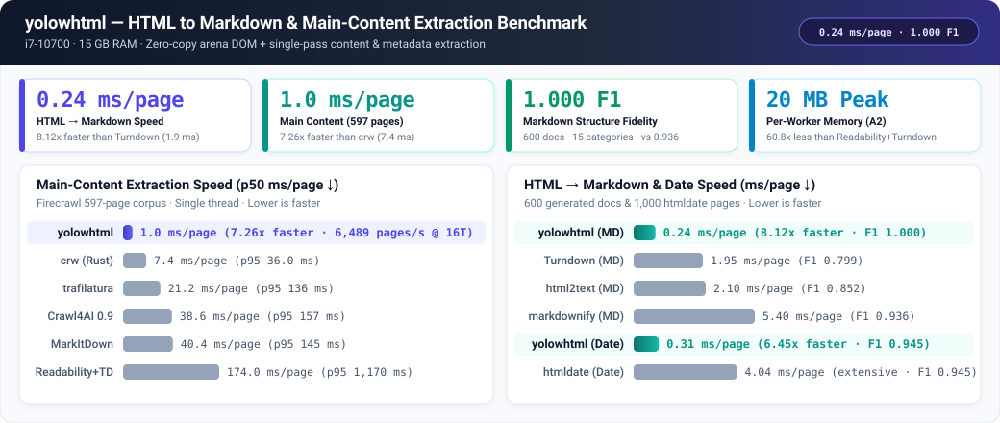
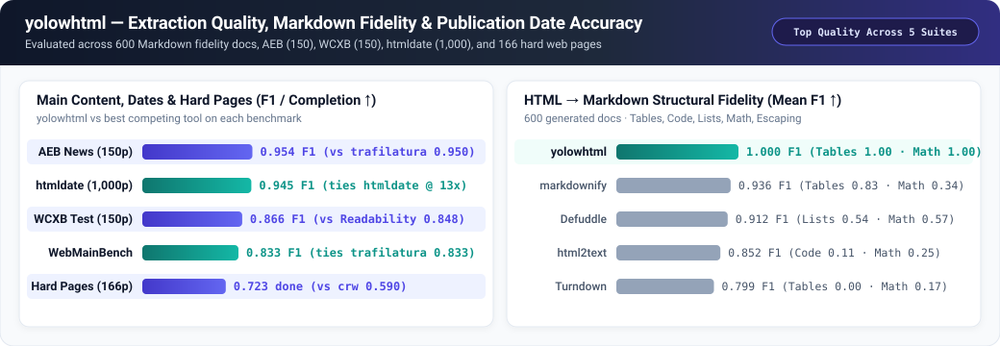
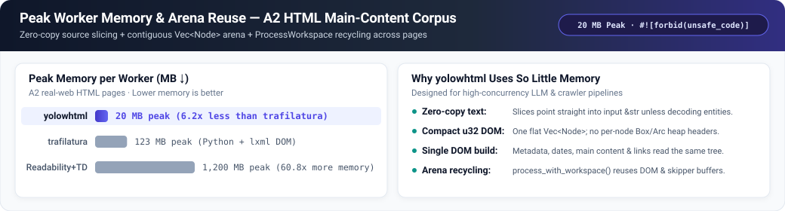
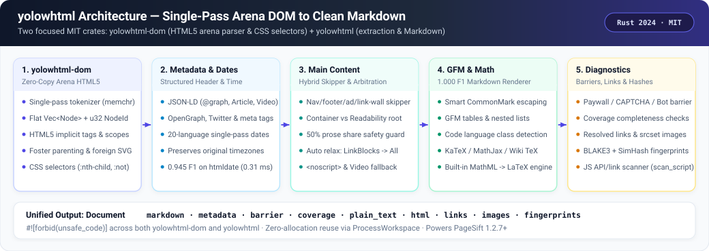

<div align="center">

# yolowhtml

**零拷贝 Arena HTML5 解析器、网页正文提取与 1.000-F1 Markdown 渲染引擎**

[**English**](../README.md) · [**简体中文**](README.zh-CN.md) · [**更新日志**](../CHANGELOG.md)

[](https://crates.io/crates/yolowhtml)
[](https://docs.rs/yolowhtml)
[](../LICENSE)
[](../Cargo.toml)

</div>

纯 Rust 实现的 HTML5 解析器（`yolowhtml-dom`）与网页正文提取 / Markdown 渲染 / 元数据 / 发布日期识别引擎（`yolowhtml`），自 [PageSift](https://github.com/YOLOW92/pagesift) 独立拆分并以 **MIT 许可证**开源。两个 crate 均启用 `#![forbid(unsafe_code)]`，每个页面**只构建一棵连续内存的 `Vec<Node>` Arena DOM 树**，即可一次性完成元数据提取、发布日期识别、正文抽取、拦截页检测与高保真 Markdown 渲染。

<p align="center">
  
</p>

---

## 核心特性速览

- **`yolowhtml`（主包 — HTML 转 Markdown 与正文提取引擎）**：基于 `yolowhtml-dom` 构建的一站式入口（`process(html, &opts)`）。负责网页正文提取、GFM Markdown 渲染（600 篇生成文档 15 个结构类别平均 F1 达 **`1.000`**）、KaTeX / MathJax / MathML → LaTeX 公式还原、20 种语言单趟发布日期识别（htmldate 1,000 页留出集 F1 **`0.945`**，单页仅 **`0.31 ms`**）、JSON-LD / OpenGraph 元数据提取、付费墙/验证码拦截页识别（`Barrier`）、完整度诊断警告（`Coverage`）及工作线程 Arena 复用（`ProcessWorkspace`）。
- **`yolowhtml-dom`（底座包 — 零拷贝 Arena HTML5 DOM 与 CSS 选择器）**：将 HTML 解析为连续内存的 `Vec<Node>` Arena 树（以 `u32` `NodeId` 索引），实现影响正文结构的 HTML5 建树规则（隐式标签、自动闭合、表格 foster parenting、SVG/MathML 外部命名空间、片段解析与 `scripting=false` 模式）、完整 HTML5 命名字符实体解码，以及 CSS 选择器引擎（`Selector::parse`、`:nth-child`、`:not`）。同时也通过 `yolowhtml::yolowhtml_dom` 直接重导出。
- **100% 安全 Rust**：`yolowhtml` 与 `yolowhtml-dom` 均强制开启 `#![forbid(unsafe_code)]`。
- **`yolow*` 开源组件家族**：与 [`yolow64`](https://github.com/YOLOW92/yolow64)、[`yolowpdf`](https://github.com/YOLOW92/yolowpdf) 一起作为核心依赖驱动 [PageSift](https://github.com/YOLOW92/pagesift) `1.2.7+`。

## 背后的故事（Story）

在开发 [PageSift](https://github.com/YOLOW92/pagesift) 的过程中，网页 HTML 处理管线几乎立刻撞上了两堵墙。

第一堵墙是**内存与重复建树**。通用 HTML 解析器往往为每个节点、属性单独分配堆内存，而常见的抓取管线为了提取元数据、识别发布时间、运行 Readability 正文打分、再把结果转成 Markdown，往往把同一份 HTML 反复解析三四遍。在 16 路并发抓取上千万真实网页时，分配器锁竞争与重复建树吞噬了大量 CPU，单 worker 峰值内存动辄飙升到数百 MB 乃至上 GB。

第二堵墙是**正文误裁与 Markdown 结构失真**。传统的 Readability 算法只挑一个“最高分节点”，遇到产品页、文档站、或者“导语在一个 `<article>`、步骤在兄弟节点”的食谱/技术页就会丢掉大半内容；而常见的 HTML-to-Markdown 库要么丢掉表格和 `<br>` 换行，要么把 KaTeX / MathJax / MathML 数学公式变成乱码，要么把正文里的 `a_b_c`、`2 * 3` 满篇乱加反斜杠，却忘了转义行首的 `1.`。

于是我们从零设计了清晰分层的两个 crate：
1. **`yolowhtml`（上层主包 — 正文提取与 Markdown 渲染引擎）**：绝大多数用户直接安装的入口 crate。它对每个页面只调用一次底层 `yolowhtml-dom`，然后**直接复用同一棵内存 DOM 树**完成全部提取步骤——包括 JSON-LD/meta 与 20 语种发布日期扫描、容器规律与 Readability 双候选仲裁（配合 50% 正文占比安全护栏）、过短结果自动多级放宽（`LinkBlocks` → `All` → `Hidden` → `<noscript>` 展开 → `VideoObject` JSON-LD 兜底），以及 `1.000` F1 保真度的 CommonMark/GFM 渲染。
2. **`yolowhtml-dom`（底层底座包 — 零拷贝 Arena HTML5 解析器与选择器）**：负责将原始 HTML 字符串解析为紧凑的 DOM 树。所有节点存放在单个连续的 `Vec<Node>` 中并用 `u32` 下标互相引用；不含字符实体的文本与属性直接切片借用源字符串 `&str`；完整实现了影响文档结构的 WHATWG HTML5 树构建规则，并提供独立的 CSS 选择器查询能力。

现在，我们将这套 HTML 解析与内容提取核心从 PageSift `1.2.6` 中独立拆出，以 **MIT 许可证**发布为 `yolowhtml` 与 `yolowhtml-dom`，并由 PageSift `1.2.7+` 直接通过依赖接入。

---

## 安装

```toml
[dependencies]
yolowhtml = "0.1"

# 如果只需要零拷贝 HTML5 Arena DOM 和 CSS 选择器：
yolowhtml-dom = "0.1"
```

---

## 快速上手

### 1. HTML 转干净 Markdown、元数据与发布日期（`yolowhtml`）

```rust
use yolowhtml::{Options, process};

let html = r#"
<!doctype html>
<html lang="zh-CN">
<head>
  <title>深入理解 Arena DOM — 技术博客</title>
  <meta property="article:published_time" content="2026-10-21T09:30:00+08:00">
</head>
<body>
  <nav><a href="/">首页</a> · <a href="/about">关于</a></nav>
  <article>
    <h1>深入理解 Arena DOM</h1>
    <p>将节点紧凑存放在 <code>Vec&lt;Node&gt;</code> 中可以彻底消除逐节点堆分配开销。</p>
    <p>行内公式如 <span class="katex"><annotation encoding="application/x-tex">E = mc^2</annotation></span> 会自动还原为 LaTeX。</p>
  </article>
  <footer>Copyright 2026</footer>
</body>
</html>
"#;

let doc = process(html, &Options::default());
assert!(doc.markdown.starts_with("# 深入理解 Arena DOM"));
assert!(doc.markdown.contains("$E = mc^2$"));
assert!(!doc.markdown.contains("Copyright 2026"));
assert_eq!(
    doc.metadata.published_time.as_deref(),
    Some("2026-10-21T09:30:00+08:00")
);
```

### 2. 工作线程级零分配 Arena 复用（`ProcessWorkspace`）

在高吞吐抓取器或批处理任务中，每个工作线程持有一个 `ProcessWorkspace`，即可跨页面复用 DOM 节点池与抽取缓冲区：

```rust
use yolowhtml::{Options, ProcessWorkspace, process_with_workspace};

let opts = Options::default();
let mut ws = ProcessWorkspace::default();

for page_html in ["<main><h1>第一页</h1><p>正文一。</p></main>", "<main><h1>第二页</h1><p>正文二。</p></main>"] {
    let doc = process_with_workspace(page_html, &opts, &mut ws);
    println!("{}", doc.markdown);
}
```

### 3. 单独使用 HTML5 Arena DOM 与 CSS 选择器（`yolowhtml-dom`）

```rust
use yolowhtml_dom::{Html, Selector};

let dom = Html::parse(r#"<div class="post"><p>第一段 &amp; 导语<p>第二段正文</div>"#);
let sel = Selector::parse("div.post > p:nth-child(2)").unwrap();

let texts: Vec<String> = dom.select(&sel).map(|n| n.text()).collect();
assert_eq!(texts, ["第二段正文"]);
```

---

## 基准评测

以下数据均在 Intel Core i7-10700（8 核 16 线程，15 GB 内存，NVMe SSD，Linux）上实测。

### 1. 速度与延迟对比

| 工作负载 | 指标 | `yolowhtml` | 最快其他工具 | 领先倍数 |
|---|---|---:|---|---:|
| **HTML → Markdown**（600 篇生成文档，单线程） | ms/页 ↓ | **0.24 ms** | Turndown `1.95 ms` | **8.12×** |
| **网页正文提取**（Firecrawl 597 页，单线程） | p50 ms/页 ↓ | **1.0 ms** | `crw` (Rust) `7.4 ms` | **7.26×** |
| **发布日期提取**（htmldate 1,000 页，日期搜索） | ms/页 ↓ | **0.31 ms** | `htmldate` (fast) `2.00 ms` | **6.45×** |

### 2. 正文提取质量与 Markdown 结构保真度

<p align="center">
  
</p>

| 评测集 | 指标 | `yolowhtml` | 对手成绩 |
|---|---|---:|---|
| **HTML → Markdown 保真度**（600 篇文档，15 类结构） | 平均 F1 ↑ | **1.000** | `markdownify` `0.936` · `Defuddle` `0.912` · `html2text` `0.852` · `Turndown` `0.799` |
| **网页正文 — AEB 新闻集**（150 页） | F1 ↑ | **0.954** | `trafilatura` `0.950` · `Readability` `0.937` · `crw` `0.846` |
| **发布日期 — htmldate**（1,000 页留出集） | F1 ↑ | **0.945** | `htmldate` (extensive) `0.945`（`4.04 ms`）· `trafilatura` `0.944` · `newspaper4k` `0.802` |
| **网页正文 — WCXB 测试集**（150 页） | F1 ↑ | **0.866** | `Readability + Turndown` `0.848` · `trafilatura` `0.839` · `crw` `0.815` |
| **困难/损坏网页**（166 页） | 完成率 ↑ | **0.723** | `crw` `0.590` · `Readability` `0.488` · `trafilatura` `0.470` |

### 3. 单 Worker 峰值内存

<p align="center">
  
</p>

---

## 架构概览

<p align="center">
  
</p>

---

## 许可证

MIT 许可证 — 详见 [LICENSE](../LICENSE)、[THIRD-PARTY.md](../THIRD-PARTY.md) 和 [UPSTREAM.md](../UPSTREAM.md)。
